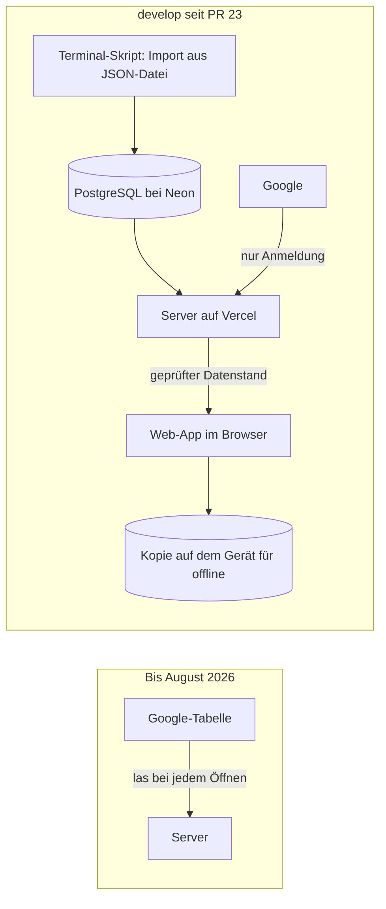

# Bestandsaufnahme: accura vor dem Neubau

> **Zielgruppe:** Steven als Produktverantwortlicher; in den Anhängen auch Agenten, die den Neubau umsetzen.
> **Zweck und Lernziel:** Auf einen Blick verstehen, was die heutige App kann, wie sie gebaut ist, was trägt, was halb fertig ist und was wackelt.
> **Voraussetzungen:** Keine. Technische Details stehen nur in den Anhängen.
> **Kanonisch für:** Den Ist-Stand von accura am 10. Oktober 2026 als Grundlage für den Neubau.
> **Verwandte Dokumente:** [Plan für den Neubau](plan.md), [Funktionen](../produkt/funktionen.md), [Entwicklungsstand](../produkt/entwicklungsstand.md), [Roadmap](../produkt/roadmap.md)

Stand: 10. Oktober 2026, Branch `develop` (Commit `eb3c562`, PR #23). Geprüft wurden Code, Doku, Entscheidungen (ADRs), alle Branches, die offenen ACC-Issues in XLR8 und die laufende App im Mock-Modus. Alle Zahlen in dieser Seite und in verlinkten Bildern stammen aus den anonymen Testdaten des Repositorys, nicht aus Stevens Finanzen.

## Kurzfassung

- **Was accura heute ist:** eine installierbare Web-App (PWA) für genau eine Person. Sie zeigt vier Ansichten: Übersicht, Demnächst, Budget, Schulden. Die Daten liegen in PostgreSQL. Anmeldung über Google.
- **Was gut ist:** Die Rechenlogik ist sauber. Geld wird in ganzen Cents gerechnet und ist mit über 230 Tests abgesichert. Datenschutz und Barrierefreiheit wurden ernst genommen. Die Doku ist ungewöhnlich gründlich.
- **Was fehlt:** Man kann in der App nichts eintragen oder ändern. Neue Stände kommen nur über ein Terminal-Skript in die Datenbank. Der fertige Editor dafür liegt unveröffentlicht in einem lokalen Arbeitsordner.
- **Was wackelt:** Die App sagt „Aktuell“, auch wenn die Kontostände Wochen alt sind. Darauf rechnet sie trotzdem „Bis Gehalt verfügbar“. Das ist für eine Geld-App das größte Vertrauensproblem.
- **Was die Web-Technik begrenzt:** Kein echter Bildschirmschutz im App-Wechsler, keine Biometrie, keine verlässlichen Erinnerungen, keine echte Android-Wallpaper-Farbe. Die PIN ist eine Hürde, keine Verschlüsselung.
- **Veröffentlichungsstand:** Die Umstellung auf PostgreSQL steckt in `develop`, aber nicht in `master`. Die Produktion läuft laut Steven (11. Oktober 2026) noch mit der Google-Tabelle.

## Was die App für den Nutzer tut

accura beantwortet fünf Fragen: Was habe ich wirklich? Was wird bis zum Gehalt noch fällig? Wie viel kann ich sicher ausgeben? Welche Schulden habe ich und wie entwickeln sie sich? Wann wird wie viel Geld frei?

### Die vier Ansichten

| Ansicht | Was man sieht | Bild (Testdaten) |
| --- | --- | --- |
| **Übersicht** | Begrüßung nach Tageszeit. Ring „Wohin geht mein Einkommen“ (Ausgaben, Rücklagen, frei). „Jetzt verfügbar“ als Summe aller Konten. Karte „Nächster Spielraum“: wann die nächste Rate endet und wie viel dann frei wird. Liste der Konten und Pockets (Unterkonten wie „Wohnen“ oder „Reise“). | [Hell](../../tests/visual/__screenshots__/chromium/412-light-overview-default.png), [Dunkel](../../tests/visual/__screenshots__/chromium/412-dark-overview.png) |
| **Demnächst** | Nächster Gehaltstag. „Bis Gehalt verfügbar“ = Kontostand minus alle Zahlungen, die vorher noch abgehen. Chronologische Liste dieser Zahlungen, mit Hinweis „5 Tage vor Gehalt“. | (keine Golden-Aufnahme) |
| **Budget** | Monatseinkommen und wie es verplant ist, gruppiert nach fünf Stufen von „existenziell“ bis „unnötig“. Rücklagen und freier Rest. Balkendiagramm nach Kategorie oder nach Notwendigkeit. | [Hell](../../tests/visual/__screenshots__/chromium/412-light-budget-categories.png) |
| **Schulden** | „Dein Weg auf null“: Ablösesumme, planmäßiges Ende, noch zu zahlende Summe, Mehrkosten gegenüber sofortiger Ablösung, Liste der Gläubiger, Restschuld-Verlauf und eine Stufen-Grafik, wie viel Geld nach jeder auslaufenden Rate frei wird. | [Eingeklappt](../../tests/visual/__screenshots__/chromium/412-light-debt-collapsed.png), [Ausgeklappt](../../tests/visual/__screenshots__/chromium/412-light-debt-expanded.png) |

Auf dem Handy liegt unten eine Navigationsleiste, auf großen Bildschirmen eine Leiste links. Jede Ansicht hat eine eigene Adresse, Zurück und Neuladen funktionieren.

### Funktionen rund um die Ansichten

- **Aktualisieren:** liest den Stand neu vom Server, von Hand oder automatisch beim Start, bei Netzrückkehr und nach zehn Minuten im Hintergrund.
- **Offline:** Der zuletzt geladene Stand bleibt auf dem Gerät und erscheint ohne Netz mit Hinweis „veraltet“.
- **Beträge ausblenden (Privacy):** das Auge oben rechts. Ersetzt Ziffern durch Buchstaben. Gedacht gegen Mitlesen über die Schulter.
- **App-Vorschau schützen:** verdeckt die App, sobald sie in den Hintergrund geht.
- **PIN-Sperre:** sechsstellige PIN beim Start und nach jedem Hintergrundwechsel. Nach fünf Fehlversuchen wächst die Wartezeit bis 15 Minuten. Wer die PIN vergisst, kann sie nur online zurücksetzen, dabei werden die lokalen Daten gelöscht. Die PIN-Punkte erscheinen kurz als wechselnde Expressive-Formen. [Bild](../../tests/visual/__screenshots__/chromium/412-light-pin-lockscreen.png)
- **Farben & Design:** System, Hell, Dunkel. Farbquelle wählbar: Browser-Akzent, neun Vorlagen oder ein eigenes Bild, aus dem lokal eine Palette berechnet wird.
- **Abmelden:** beendet die Sitzung. Die Daten auf dem Server bleiben, der lokale Zwischenspeicher wird erst nach erneuter Anmeldung derselben Person wieder gezeigt.

### Was die App bewusst nicht kann

- Keine Bankanbindung, keine Transaktionen, keine automatische Kategorisierung.
- Kein Eintragen oder Ändern von Daten in der App (siehe [Halb fertig](#halb-fertig)).
- Nur eine Person. Die erlaubte Google-Adresse steht fest in der Serverkonfiguration.
- Nur Euro, nur monatlich wiederkehrende Zahlungen, nur ein Einkommen mit einem Gehaltstag.

## Woher die Zahlen kommen

Kurz erklärt: accura speichert keine fertigen Summen. Es speichert Bausteine und rechnet bei jedem Öffnen neu.

- **Stammdaten:** Konten, Pockets, Budgetposten (Betrag, Notwendigkeit, Fälligkeitstag), Schulden (Rate, Fälligkeitstag).
- **Stände mit Datum („Snapshots“):** Kontostand am Tag X, Restschuld am Tag X. Ältere Stände bleiben erhalten.
- **Meilensteine:** geplante Restschuld zu einem Monat und Entlastungen („ab März 120 € mehr frei“).
- **Stichtag:** ein Datum für den ganzen Datenstand. Für jedes Konto nimmt die App den jüngsten Stand bis zu diesem Tag.

Daraus rechnet sie: verfügbar, sicher verfügbar bis Gehalt, Budget-Aufteilung, Restschuld, Mehrkosten, frei werdendes Geld. Wichtige Regeln, die sich bewährt haben und im Neubau gleich bleiben sollten:

- Geld immer in ganzen Cents, nie als Kommazahl.
- Pockets sind eine zweite Sicht auf dasselbe Geld und werden nie zum Kontostand addiert.
- Ein Fälligkeitstag 31 rutscht in kurzen Monaten auf den letzten Tag.
- Zahlungen am Gehaltstag selbst zählen nicht mehr zu „vor dem Gehalt“.
- Negative Stände bleiben negativ und werden nicht auf null geschönt.

## Wie die Daten fließen

1. **Früher:** Die Daten lagen in einer Google-Tabelle mit zehn festgelegten Blättern. Der Server las sie bei jedem Öffnen.
2. **Umzug (August 2026):** Der Tabelleninhalt wurde einmalig nach PostgreSQL übernommen, ausgeliefert wurde das aber nie. Laut XLR8 sind Backup-Übung, Migrationen, enge Datenbankrechte und Import abgehakt (ACC-74 bis ACC-77). Offen ist nur das Aufräumen alter Google- und Vercel-Einstellungen (ACC-78).
3. **Heute:** Die App holt den kompletten Datenstand vom Server, prüft ihn und zeigt ihn an. Der Server prüft vorher die Google-Anmeldung und ob es die erlaubte Person ist.
4. **Neue Stände eintragen:** nur durch ein Skript im Terminal, das den gesamten Stand aus einer JSON-Datei ersetzt.

## Was gut funktioniert

- **Rechenkern:** klar getrennt von der Oberfläche, deterministisch, mit Grenzfällen getestet (Monatsende, Schaltjahr, negative Stände, leere Daten, extreme Beträge). 235 Unit-Tests liefen bei dieser Prüfung grün.
- **Datenprüfung an jeder Grenze:** Server und App prüfen den Datenstand. Ein fehlerhafter Stand wird nie halb angezeigt.
- **Datenbank-Design:** Jede Zeile gehört fest zu einem Besitzer. Querverweise über Besitzergrenzen lehnt die Datenbank ab. Das ist eine gute Vorlage für Mehrbenutzer.
- **Offline und Fehlerfälle:** durchdacht, mit sichtbaren Zuständen statt leerer Bildschirme.
- **Barrierefreiheit:** Screenreader-Texte für Diagramme, große Touch-Flächen, reduzierte Bewegung, Kontrastmodus. Automatische Axe-Prüfungen und 38 Referenz-Screenshots.
- **Tonalität:** ruhige, respektvolle Texte ohne Scham oder Gamification.
- **Doku und Entscheidungen:** 14 ADRs und eine vollständige deutsche Doku. Für den Neubau ist das die wertvollste Hinterlassenschaft neben dem Rechenkern.

## Halb fertig

- **In-App-Editor (ACC-72):** fast fertig, aber **nicht committet**. Er liegt nur im lokalen Ordner `accura-acc-72` (etwa 3.000 Zeilen inklusive Tests und ADR 0015). Er kann Stände, Beträge, Fälligkeitstage und aktiv/inaktiv ändern, aber nichts anlegen oder löschen. Für den Neubau ist er als Fachvorlage wertvoll, zum Beispiel für den Konfliktschutz bei gleichzeitigen Änderungen. Er sollte gesichert werden, auch wenn der Code verworfen wird.
- **Lokale Entwicklung gegen echte Datenbank (Branch `grok/acc-73-…`):** fertig, ohne PR.
- **README-Update (PR #24):** offen, fertig.
- **Design-Notizen zu Material 3 Expressive:** ausführlich, aber nur als ungespeicherte Änderung im Hauptordner (`docs/architektur/material-3-expressive.md` und zehn geänderte Seiten). Inhaltlich gute Grundlage für das Design des Neubaus.
- **Freigabe an `master`:** `develop` ist 13 Commits weiter als `master`. Die ganze PostgreSQL-Umstellung ist dort noch nicht freigegeben.
- **Alte Einstellungen aufräumen (ACC-78):** offen.

## Was wackelt

Sortiert nach Bedeutung für das Vertrauen in die Zahlen.

1. **„Aktuell“ heißt nicht aktuell.** Der grüne Haken bedeutet nur: Der Server wurde gerade erreicht. Wie alt die Kontostände sind, zeigt die App nicht deutlich. In den Testdaten steht „Aktuell“ über Kontoständen von vor zwei Monaten. „Ablösesumme heute“ zeigt ebenfalls den alten Stand.
2. **Alte Stände, heutiges Datum.** „Bis Gehalt verfügbar“ zieht die Zahlungen ab heute vom letzten bekannten Kontostand ab. Ist der Kontostand älter, sind manche Zahlungen schon abgebucht und werden doppelt abgezogen, oder Eingänge fehlen. Die Zahl wirkt exakt, ist es aber nicht. Die Lösung ist fachlich (Datenalter zeigen, Stände leicht aktualisieren), nicht technisch. Siehe ACC-16 und ACC-17.
3. **Pflege nur über das Terminal.** Solange der Editor fehlt, veralten die Daten im Alltag zwangsläufig. Punkt 1 und 2 verschärfen sich dadurch.
4. **Web-Grenzen beim Schutz.** Die App kann den Bildschirm im App-Wechsler nicht zuverlässig schwärzen und keine Biometrie nutzen. Die Offline-Kopie liegt unverschlüsselt im Browser. Die Doku sagt das ehrlich, eine native App kann es besser.
5. **Fehlende Sicherheits-Header.** Die ausgelieferte Seite hat weiterhin keine Content-Security-Policy und keinen Schutz gegen Einbetten (ACC-13, Audit ACC-70, Befund SEC-02). Bei einer nativen App entfällt dieses Thema größtenteils.
6. **Ein Nutzer fest eingebaut.** Die erlaubte E-Mail-Adresse steht in der Konfiguration. Der Import ersetzt „den einzigen Besitzer“. Mehrbenutzer bräuchte Umbau an Anmeldung, Sitzungen und Rechten (ACC-64).
7. **Design nicht aus einem Guss.** Beim Durchklicken fallen auf:
   - zwei verschiedene Ring-Stile (Übersicht und Budget);
   - ein Euro-Zeichen, das allein in die nächste Zeile rutscht („Nächster Spielraum“);
   - der Zahnrad-Knopf heißt „Einstellungen“, der Dialog „Informationen“;
   - das Ziel „schuldenfrei“ trägt einen steigenden Pfeil;
   - die Schulden-Hauptkarte steht in Rosa auf Warnfarbe, was bei ängstlichen Nutzern Druck erzeugen kann.

   Expressive-Formen gibt es fast nur auf dem PIN-Bildschirm. Diagramme stammen aus einer Web-Bibliothek und folgen nicht dem Material-Stil. Rund 3.700 Zeilen eigenes CSS bilden Material nach, weil es im Web keine fertige Expressive-Bibliothek gibt.
8. **Fachliche Vereinfachungen.** Nur monatliche Zahlungen, keine Verschiebung auf Bankarbeitstage, nur ein Einkommen. Für den Start in Ordnung, aber wichtig für spätere Nutzer.

## Was aus Doku, Entscheidungen und Issues an Absichten erkennbar ist

- **Richtung vor dem Neubau-Gedanken:** PostgreSQL als einzige Quelle, dann Editor, dann Anmeldung für mehrere getrennte Nutzer, dann angstfreies Onboarding, dann Freigabe an weitere Personen (ACC-65 → ACC-72 → ACC-64 → ACC-67 → ACC-81).
- **Play Store war schon Thema:** ACC-60 wollte eine „native Hülle“ prüfen, um Dynamic Color, Biometrie, Widgets und Erinnerungen zu bekommen. Der Neubau beantwortet diese Frage grundsätzlicher.
- **Produktgrenzen sind beschlossen:** kein All-in-one, keine Investments, keine Kredit- oder Affiliate-Vermarktung, keine Gamification. Bankanbindung nur nach Sicherheits- und Nutzenprüfung.
- **Zukunftsideen sind zahlreich:** etwa 40 Backlog-Issues ohne Priorität, von Spar-Simulatoren bis KI-Assistent. Sie sind Ideen, keine Zusagen.
- **Vertrauen ist der rote Faden:** Fast jedes hoch priorisierte Issue zielt auf korrekte, erklärbare und geschützte Zahlen, nicht auf mehr Funktionen.

## Offene ACC-Issues und ihre Bedeutung für den Neubau

56 offene Issues im ruhenden Team ACC (gelesen am 10. Oktober 2026, nur lesend). Vorschlag zur Einordnung:

- **v1:** gehört in die erste Version des Neubaus.
- **in neuer Form:** das Ziel bleibt, die Umsetzung ändert sich durch den Neubau.
- **später:** zählt weiter, aber nach v1.
- **Alt-App:** betrifft nur die heutige App bis zur Ablösung.
- **entfällt:** erledigt sich durch den Neubau oder widerspricht dem Produkt.

### Hoch priorisiert

| Issue | Thema | Einordnung | Warum |
| --- | --- | --- | --- |
| ACC-64 | Anmeldung und getrennte Nutzerkonten | **v1** (nur Anmeldung) | Clerk-Anmeldung für Steven allein. Weitere Nutzer sind nicht vorgesehen (Beschluss vom 11. Oktober 2026). |
| ACC-65 | Eigenes Datenmodell und sichere Bearbeitung | **v1** | Kern des Neubaus. |
| ACC-72 | In-App-Editor | **v1** | Ohne Bearbeiten in der App veralten die Daten. Der unveröffentlichte Editor dient als Fachvorlage. |
| ACC-67 | Angstfreies Erst-Onboarding | **v1** (schlank) | Der Neubau startet ohne Datenumzug leer. Steven erfasst seine Daten in der App. |
| ACC-81 | Freigabe für weitere Nutzer | **entfällt** vorerst | accura bleibt eine App nur für Steven (Beschluss vom 11. Oktober 2026). |
| ACC-80 | Design-/UX-Prüfung mit GPT-6 Astra | **in neuer Form** | Wird zur Design-Phase des Neubaus mit klickbaren Prototypen. |
| ACC-13 | Datensparsame Fehlerdiagnose, Security-Header | **in neuer Form** | Header entfallen bei nativer App. Datensparsames Absturz-Logging bleibt Pflicht. |
| ACC-68 | Lizenz und Markenschutz vor Codex-for-OSS | **entfällt** vorerst | Das neue Repo ist privat. Die Frage kommt erst bei einer Veröffentlichung wieder. |
| ACC-66 | Sheets nach Postgres importieren | **entfällt** | Nie ausgeliefert. Der Neubau startet ohne Datenumzug. |
| ACC-73, ACC-78 | Pre-Deployment, alte Google-/Vercel-Reste entfernen | **entfällt** | Die alte App wird abgeschaltet, nicht weiterentwickelt. |

### Mittel priorisiert

| Issue | Thema | Einordnung | Warum |
| --- | --- | --- | --- |
| ACC-11 | Visuelle Regressionstests | **in neuer Form** | Wird zu Screenshot-Tests der Android-Oberfläche. |
| ACC-70 | Grok-Sicherheitsaudit auswerten | **in neuer Form** | Die Web-Befunde entfallen. Übrig bleiben Export, Sitzungen und Zugriffsschutz für einen Besitzer. Danach schließen. |

### Ohne Priorität (Backlog)

| Issue | Thema | Einordnung |
| --- | --- | --- |
| ACC-16 | Aktualisierungs-Checkliste für Konten, Pockets, Schulden | **v1**: löst das Kernproblem veralteter Stände |
| ACC-17 | Datenalter je Bereich zeigen | **v1**: siehe „Was wackelt“ Punkt 1 |
| ACC-37 | Jede Finanzaussage mit sichtbarer Rechnung begründen | **v1** als Prinzip: „So gerechnet“ zu jeder Hauptzahl |
| ACC-58 | PDF-Export, anonymisierte Übersicht | **später**; ein einfacher Datenexport gehört aber in v1 |
| ACC-48 | Erinnerungen bei veralteten Daten | **später**, früh nach v1; nativ gut machbar |
| ACC-60 | Native Android-Hülle prüfen | **entfällt**: durch den Neubau beantwortet |
| ACC-18, ACC-19 | Aufklappbare Budgetposten, Detailansichten | **später**; teilweise im Editor enthalten |
| ACC-24, ACC-25 | Mehrere Einkommen, vollständige wiederkehrende Zahlungen | **später**; das Datenmodell sollte die Erweiterung nicht verbauen |
| ACC-20, ACC-21, ACC-23 | Verlauf, Veränderungen, Monatsvergleich | **später** |
| ACC-22, ACC-30, ACC-31, ACC-33 | Nettovermögen, Puffer, Tagesrahmen, Reichweite Rücklagen | **v1** als berechnete Kennzahlen, siehe [Plan](plan.md#rechnen-und-erkenntnisse) |
| ACC-26, ACC-27, ACC-43 | Sparziele, Zinsdaten, Sparziel-Simulator | **v1** für vollständige Kreditdaten (ACC-27); Sparziele **später** |
| ACC-28, ACC-32, ACC-34 | Ist-Ausgaben, Plan-Ist-Vergleich, Einspar-Check | **v1** für Einspar-Hinweise zu Abos, Lebensmitteln und Notwendigkeit (ACC-34); Ist-Ausgaben **später** |
| ACC-35, ACC-36 | Geld verteilen, Warnkarten | **später** |
| ACC-38 bis ACC-42, ACC-44 | Tilgungs- und Was-wäre-wenn-Simulationen, Cashflow-Kalender | **später** |
| ACC-46, ACC-47, ACC-49 | CSV-Import, Kategorisierung, Open Banking | **später**; Open Banking nur nach Prüfung |
| ACC-50 bis ACC-56 | Insight-Engine, KI-Assistent und Schutzgrenzen | **später**, eigenes Vorhaben |
| ACC-57 | Startseite frei anpassbar | **entfällt** (Vorschlag): widerspricht der festen, ruhigen Reihenfolge |
| ACC-59 | Haushalte, mehrere Währungen | **entfällt** bis echter Bedarf belegt ist |

Die Einordnung ist am 11. und 13. Oktober 2026 an Stevens Antworten angepasst. Vorschlag zum Aufräumen: Steven schließt die mit „entfällt“ und „Alt-App“ markierten Issues nach Ablösung der alten App. Die „v1“-Issues überführt er in das neue Neubau-Team oder -Projekt. Alles „später“ bleibt im ruhenden Backlog.

## Offene Punkte aus der Bestandsaufnahme

- **Was läuft in der Produktion?** Geklärt am 11. Oktober 2026: Die Produktion läuft noch mit der Google-Tabelle. Die PostgreSQL-Umstellung wurde nie ausgeliefert. Für den Neubau heißt das: kein Datenumzug, Start von null (siehe [Plan](plan.md#start-ohne-datenumzug)).
- **Der Editor-Ordner `accura-acc-72`** sollte gesichert werden, etwa als Commit auf seinem Branch, bevor er verloren geht. Das gilt auch, wenn der Code nicht weiterverwendet wird.
- **Die geparkten Design-Notizen im Hauptordner** sollten aus demselben Grund gesichert werden.

## Anhang A: Technischer Steckbrief

| Bereich | Heute |
| --- | --- |
| Oberfläche | React 19, TypeScript, Vite 7, PWA mit Workbox-Service-Worker |
| Diagramme und Bewegung | Recharts, `motion`, `shape-morph` (Expressive-Formen nur am PIN-Screen) |
| Farben | `@material/material-color-utilities`, eigene Tokens in CSS (etwa 3.700 Zeilen CSS) |
| Server | Vercel Functions (`api/`): `/api/session`, `/api/finance`, OAuth-Start, -Callback, Logout |
| Anmeldung | Google OAuth mit PKCE, State und Nonce, nur `openid email profile`; HMAC-signiertes Session-Cookie; eine erlaubte E-Mail |
| Datenbank | PostgreSQL (Neon), Migrationen 001–003, zehn Finanztabellen plus `owners`, alle Schlüssel mit `owner_id` |
| Geld | `BIGINT` in Cents in der Datenbank, sichere Ganzzahlen in TypeScript, Zod-Prüfung an jeder Grenze |
| Lokale Speicher | IndexedDB (Offline-Kopie, Bildvorschau), localStorage (Darstellung, Privacy, PIN-Prüfwert) |
| Tests | 235 Vitest-Tests, 14 echte PostgreSQL-Fälle, 11 Node-Tests, Playwright mit 38 Golden Screenshots und Axe, Smoke-Tests für PWA und Offline |
| CI | GitHub Actions: Lint, Lizenzen, Unit-Tests, PostgreSQL-Suite, Build, Smoke |
| Umfang | etwa 12.300 Zeilen Produktionscode, etwa 3.500 Zeilen Tests |
| Lizenz | AGPL-3.0-only, Marke und Logo ausgenommen |

Kanonische Details: [Architekturüberblick](../architektur/ueberblick.md), [Finanz-Domäne](../architektur/finanz-domaene.md), [Datenbank](../referenz/datenbank.md), [Backend und Sicherheit](../architektur/backend-und-sicherheit.md).

## Anhang B: Datenmodell heute

| Tabelle | Inhalt | Wichtige Felder |
| --- | --- | --- |
| `owners` | Besitzer | interne UUID, Google-`sub` |
| `finance_meta` | ein Datensatz je Besitzer | Stichtag, Währung (nur EUR), Monatseinkommen, Gehaltstag |
| `accounts` / `account_snapshots` | Konten und datierte Kontostände | Art (Bank, Wallet, Bargeld), Reihenfolge, aktiv |
| `pockets` / `pocket_snapshots` | Unterkonten und datierte Stände | gehören zu einem Konto |
| `budget_items` | Budgetposten | Monatsbetrag, Notwendigkeit (5 Stufen), Ausgabe oder Rücklage, Fälligkeitstag, Notiz |
| `debts` / `debt_snapshots` | Schulden und datierte Stände | Kredit oder Ratenkauf, Monatsrate, Fälligkeitstag; Ablösesumme, verbleibende Raten, planmäßige Restsumme |
| `debt_milestones` | geplanter Restschuld-Verlauf | Datum mit Monats- oder Tagesgenauigkeit, Restschuld |
| `relief_milestones` | Entlastungsereignisse | Datum, monatlich frei werdender Betrag, Titel |

Die Datenbank speichert keine Summen. Alle Ableitungen rechnen die reinen Funktionen in `src/finance/selectors.ts` und `src/finance/upcoming.ts`. Für den Neubau sind diese Funktionen und ihre Tests die präziseste Fachspezifikation, die es gibt.

## Anhang C: Branches und Arbeitsstände

| Stand | Inhalt | Zustand |
| --- | --- | --- |
| `develop` (`eb3c562`) | PostgreSQL als einzige Quelle | aktuell, 13 Commits vor `master` |
| `master` (`2d81edb`) | Stand vor der PostgreSQL-Umstellung (PR #19) | Produktionsbranch |
| `grok/acc-73-postgres-pre-deployment-work` | `vercel dev` gegen echte Datenbank, Konfigurationsfehler sauber melden | fertig, kein PR |
| `aleister/0003-readme-aktualisieren` | README nach Umstellung (PR #24) | fertig, PR offen |
| Ordner `accura-acc-72` (Branch `claude/ACC-72-…`) | In-App-Editor mit `PATCH /api/finance`, Konfliktschutz, Spaltenrechten, ADR 0015 | fast fertig, **nicht committet** |
| Hauptordner (auf `grok/acc-73-…`) | Doku zu Material 3 Expressive | ungespeicherte Änderungen |
| `grok/ACC-72-in-app-finance-editor` | leer | verlassen |
| zwölf weitere `codex/`- und `grok/`-Branches | bereits über PR #11 bis #23 gemergt | können gelöscht werden |

## Anhang D: Wie diese Bestandsaufnahme entstand

- Doku unter `docs/` vollständig gesichtet, insbesondere Produkt-, Architektur- und Referenzseiten sowie der ADR-Index.
- `npm ci` und `npm test` im Worktree: 33 Testdateien, 235 Tests grün. Die PostgreSQL-Suite wurde nicht ausgeführt (braucht eine Test-Datenbank).
- App lokal mit `VITE_USE_MOCK_API=true` gestartet und im Pixel-7-Format durchgeklickt: alle vier Ansichten und Einstellungen. Ohne Zugangsdaten, nur anonyme Testdaten.
- Branches mit `git log` und `git diff` gegen `finance-overview/develop` verglichen. Den Editor-Ordner und den Hauptordner nur lesend geprüft. Keine `.env`-Dateien gelesen.
- XLR8: Team ACC, 56 offene Issues gelistet, Kern-Issues einzeln gelesen. Nichts geändert.
