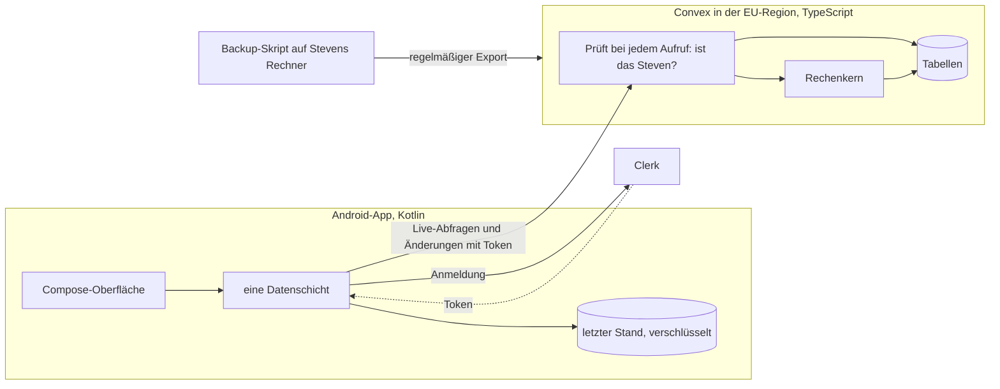

# Plan für den Neubau als Android-App

> **Zielgruppe:** Steven als Entscheider; in den Anhängen auch Agenten, die den Neubau umsetzen.
> **Zweck und Lernziel:** Verstehen, was der Neubau umfasst, womit er gebaut wird, was er berechnet und in welchen Schritten er entsteht.
> **Voraussetzungen:** [Bestandsaufnahme](bestandsaufnahme.md)
> **Kanonisch für:** Umfang, Technik, Berechnungen, Design-Weg und Phasen des Neubaus. Die Grundzüge sind beschlossen, Details offen.
> **Verwandte Dokumente:** [Produktüberblick](../produkt/ueberblick.md), [Roadmap](../produkt/roadmap.md), [Finanz-Domäne](../architektur/finanz-domaene.md)

Erster Vorschlag am 10. Oktober 2026. Am 11. und 13. Oktober 2026 hat Steven die offenen Fragen beantwortet, dieser Stand ist eingearbeitet ([Beschlüsse](#beschlüsse)). Gebaut ist noch nichts. Die Quellen für alle Versions-, Reife- und Preisangaben stehen in [Anhang D](#anhang-d-quellen).

## Kurzfassung

- **Für wen:** nur für Steven. Weitere Nutzer sind nicht vorgesehen. Das hält Datenschutz und Aufwand klein.
- **Technik:** Kotlin mit Jetpack Compose, Convex als Backend, Clerk für die Anmeldung. Nur in Compose gibt es Material 3 Expressive als fertige, offizielle Bausteine.
- **Rechnen auf dem Server:** Die Finanzlogik läuft als TypeScript in Convex, die App zeigt nur an. accura soll so viel wie möglich vorrechnen, damit am Ende wenige, wichtige Zahlen bleiben. Jede Zahl lässt sich aufklappen und zeigt ihren Rechenweg.
- **Umfang v1:** die vier Ansichten, neu gestaltet, dazu berechnete Kennzahlen zu Spielraum, Puffer und Schulden. Daten werden in der App erfasst und gepflegt, das Datenalter steht überall dabei. Google-Tabelle, Web-Version, Bildfarben und die eigene PIN fallen weg.
- **Kein Datenumzug, keine Tabelle mehr:** Der Neubau startet leer. Die Google-Tabelle ist veraltet und wird weder importiert noch als Quelle genutzt. Alles passiert in der App, und Erfassen und Pflegen muss extrem einfach sein.
- **Einspar-Hinweise:** Die App schlägt konkret vor, wo sich sparen lässt, etwa bei Abos oder bei Lebensmitteln im Vergleich zu einem Richtwert für den Haushalt.
- **Kredite vollständig:** Zins, Laufzeit, Rate und Startbetrag werden erfasst. Die Restschuld rechnet die App nach dem Tilgungsplan selbst.
- **Kostenlos:** Convex und Clerk im kostenlosen Plan, Convex in der EU-Region. Automatische Backups gibt es dort nicht, deshalb sichert ein kleines Skript auf Stevens Rechner regelmäßig.
- **Auslieferung:** kein Play Store. Die App wird lokal gebaut und per ADB auf Stevens Pixel installiert.
- **Schutz:** Sperre mit Fingerabdruck oder Gesicht, Bildschirmschutz gegen Screenshots und App-Wechsler, verschlüsselte Offline-Kopie.
- **Design:** erst klickbare Prototypen, dann Umsetzung.
- **Größte Risiken:** Der Convex-Client für Kotlin ist noch vor Version 1.0. Bearbeiten geht nur mit Netz. App und Backend sprechen zwei Sprachen und brauchen einen Vertragstest dazwischen.

## Beschlüsse

### 11. Oktober 2026

| Frage | Beschluss | Folge für den Plan |
| --- | --- | --- |
| Technik | Kotlin mit Compose, Convex, Clerk | Expo ist vom Tisch. Der Vergleich bleibt unten als Begründung stehen. |
| Web-Version | Nicht in v1 | Frühestens in einer späteren Version, dann neu gebaut. |
| Repository | Neues, privates Repo. Das alte accura wird abgestellt. | Lizenzfrage (ACC-68) entfällt vorerst. |
| Name und Vertrieb | Name bleibt „accura“. Kein Play Store, nur lokal auf Stevens Handy. | Kein Play-Konto, keine Store-Pflichten. Installation per ADB. |
| Play-Konto | Nicht nötig | Entfällt. |
| Kosten | Nur kostenlose und vorhandene Mittel | Kostenlose Pläne von Convex und Clerk, eigenes Backup-Skript statt Pro-Plan. |
| Entlastungen | Berechnen statt pflegen. Generell so viel wie möglich vorrechnen. | Neuer Abschnitt [Rechnen und Erkenntnisse](#rechnen-und-erkenntnisse). |
| App-Schutz | Gerätesperre statt PIN, Biometrie, Screenshots sperren | Alles in v1. |
| Produktion heute | Läuft noch mit der Google-Tabelle | Kein Datenumzug. Start von null. |
| Weitere Nutzer | Nicht vorsehen | Keine Alpha-Phase, keine Rechtstexte, kein Konto-Löschen für Fremde. |

### 13. Oktober 2026

| Frage | Beschluss | Folge für den Plan |
| --- | --- | --- |
| Google-Tabelle | Nicht mehr darauf vertrauen, sie ist veraltet und war zu pflegeaufwendig | Weder Import noch Nachschlagewerk. Die Ersterfassung stützt sich auf Banking-App und Verträge. Neuer Abschnitt [Erfassen, so einfach wie möglich](#erfassen-so-einfach-wie-möglich). |
| „Sparmaßnahmen“ | Konkrete Empfehlungen, wo man sparen kann, etwa unnötige Abos oder zu viel Geld für Essen | Neuer Abschnitt [Einspar-Hinweise](#einspar-hinweise). Die Leitlinie zu Bewertungen ist angepasst. |
| Zinssätze | Bekannt, gehören in die App, am besten alle Kreditdaten | [Kredite vollständig erfassen](#kredite-vollständig-erfassen), Restschuld nach Tilgungsplan |
| Anmeldung | Clerk, aber mit eigener Oberfläche, die nahtlos zur App passt | Eigene Anmeldeseiten in Compose über `clerk-android-api` |
| PR #25 | Mergen | Gemergt in `develop` |
| Altes Repo | Seit 13. Oktober 2026 privat | Keine Änderung am Plan. Echte Finanzdaten gehören trotzdem nie ins Repo. |
| Google-Anmeldung | Nicht gewünscht, nur Clerk | Anmeldung per E-Mail-Code. Kein Google-Cloud-Konto, kein OAuth-Client. Entscheidung Stevens, 13. Oktober 2026, während Phase 0. |

## Leitlinien für den Neubau

Diese Regeln gelten weiter. Sie stammen aus Doku und `agents.md` und haben sich bewährt.

- accura bleibt ein ruhiges Finanz-Cockpit. Kein All-in-one, keine Investments, keine Gamification, kein Verkauf von Krediten.
- Jede Zahl muss stimmen, erklärbar sein und ihr Alter zeigen. Lieber eine sichtbare Unsicherheit als eine falsche Genauigkeit.
- Die App rechnet vor und macht Vorschläge, der Mensch entscheidet. Vorschläge sind ruhig, begründet, abwählbar und nie beschämend. Keine Empfehlungen für Finanzprodukte oder Anbieter.
- Was sich berechnen lässt, wird nicht abgefragt. Jede Eingabe hat einen sinnvollen Vorschlag.
- Geld immer in ganzen Cents.
- Sicherheit, Datenschutz und Barrierefreiheit sind Teil jeder Phase, kein Feinschliff am Ende.
- So einfach wie möglich. Keine Bibliothek und keine Abstraktion ohne aktuellen Grund.

## Umfang v1

v1 ist fertig, wenn Steven seine Finanzen nur noch mit der neuen App führt und die alte App abgeschaltet ist.

### Übernehmen

| Was | Warum |
| --- | --- |
| Übersicht, Demnächst, Budget, Schulden | Sie beantworten die fünf Kernfragen. Inhalt bleibt, Gestaltung wird neu. |
| Alle Rechenregeln aus der Finanz-Domäne | Sie sind getestet und fachlich geprüft. Siehe [Finanz-Domäne](../architektur/finanz-domaene.md). |
| Snapshots, also Stände mit Datum und Verlauf | Ohne sie gibt es keinen Restschuldverlauf und kein Datenalter. |
| Pockets und fünf Notwendigkeitsstufen | Gehören zu Stevens Art, mit Geld umzugehen. Die Stufen tragen außerdem den Einspar-Check. |
| Beträge ausblenden | Bewährt. Neu mit gleichförmigen Punkten statt umkehrbarer Buchstaben (Audit-Befund SEC-05). |
| Offline lesen | Der letzte Stand bleibt mit Altershinweis sichtbar. |
| Hell, Dunkel, System | Bewährt. |
| Ruhige deutsche Texte | Teil des Produkts. Bestehende Formulierungen sind eine gute Vorlage. |

### Neu in v1

| Was | Warum | Issue |
| --- | --- | --- |
| Anmeldung mit Clerk, eigene Oberfläche | Nur Steven kommt hinein. Clerk prüft im Hintergrund, die Anmeldeseiten sind accura-Bildschirme. | ACC-64 (nur Anmeldung) |
| Ersterfassung in der App | Der Neubau startet leer. Ein geführter Ablauf: Einkommen, Gehaltstag, Konten, Pockets, Budgetposten, Schulden. | ACC-67 |
| Bearbeiten in der App | Anlegen, ändern, deaktivieren. Ohne das veralten die Daten. | ACC-65, ACC-72 |
| „Stände aktualisieren“ | Ein geführter Ablauf: alle Kontostände und Restschulden nacheinander, mit dem alten Wert als Vorschlag. | ACC-16 |
| Datenalter überall sichtbar | „Stand vom 3. Okt.“ statt „Aktuell“. Ab einer Schwelle ein ruhiger Hinweis. | ACC-17 |
| Berechnete Kennzahlen | Spielraum, Puffer, Quoten, Schuldenfrei-Datum, Entlastungen. Siehe [Rechnen und Erkenntnisse](#rechnen-und-erkenntnisse). | ACC-22, ACC-30, ACC-31, ACC-33 |
| Einspar-Hinweise | Abos, Lebensmittel gegen Richtwert, Posten mit niedriger Notwendigkeit. Siehe [Einspar-Hinweise](#einspar-hinweise). | ACC-34 |
| Vollständige Kreditdaten | Zins, Laufzeit, Rate, Startbetrag. Die Restschuld folgt dem Tilgungsplan und muss nicht mehr gepflegt werden. | ACC-27 |
| „So gerechnet“ | Ein Tipp auf eine Zahl zeigt die Rechnung mit den einbezogenen Posten. | ACC-37 |
| Datenexport | Eine vollständige Datei aller Daten, jederzeit aus der App. | ACC-58 (teilweise) |
| Sperre mit Biometrie | Fingerabdruck oder Gesicht beim Start und nach Zeit im Hintergrund. | – |
| Dynamic Color | Echte Android-Farben aus dem Hintergrundbild. | ACC-60 |

### Fällt weg

| Was | Warum |
| --- | --- |
| Google-Tabelle als Format, Import und Quelle | Veraltet und pflegeaufwendig. Die neue App ist die einzige Quelle. |
| Web-App und PWA | Nicht in v1. Eine spätere Web-Version wird neu gebaut. |
| Farbanalyse aus eigenem Bild, neun Farbvorlagen | Android liefert Dynamic Color selbst. Bleibt nur ein accura-Standardschema als Rückfall. |
| Eigene sechsstellige PIN | Ersetzt durch Biometrie mit der Geräte-PIN als Rückfall. Sicherer und weniger Code. |
| Globaler Stichtag für alle Daten | Ein Überbleibsel der Tabelle. Jeder Stand hat sein eigenes Datum, gerechnet wird mit dem jüngsten Stand bis heute. |
| Von Hand gepflegte Entlastungen | Werden aus den Schulden berechnet. |
| Tablet- und Desktop-Layout | v1 nur Handy. |
| Vercel Analytics, jede Nutzungsanalyse | Keine Nutzungsdaten an Dritte. |
| Mehrere Nutzer, Konto löschen, Rechtstexte | accura bleibt eine App für Steven allein. |

### Bewusst nicht in v1

Alles mit „später“ aus der [Issue-Einordnung](bestandsaufnahme.md#offene-acc-issues-und-ihre-bedeutung-für-den-neubau). Das Datenmodell soll zwei Erweiterungen nicht verbauen: mehrere Einkommen (ACC-24) und Zahlungen in anderen Abständen als monatlich (ACC-25). Mit Convex ist eine spätere Erweiterung des Modells unkompliziert.

## Erfassen, so einfach wie möglich

Die alte Tabelle ist gescheitert, weil die Pflege zu viel Arbeit war. Die neue App muss deshalb mit wenig Eingaben auskommen. Ziele für den Klick-Dummy: Die Ersterfassung schafft Steven in einer Sitzung, ein Monats-Update in unter zwei Minuten.

- **Geführte Ersterfassung.** Ein Thema pro Bildschirm: Einkommen und Gehaltstag, Konten, Pockets, feste Kosten, Kredite, Haushalt. Jederzeit unterbrechbar, der Fortschritt bleibt. Quelle sind Banking-App und Verträge, nicht die alte Tabelle.
- **Nicht fragen, was sich rechnen lässt.** Restschuld, Schuldenfrei-Datum, Entlastungen und Zinskosten folgen aus den Kreditdaten. Steven trägt sie nicht ein.
- **„Stände aktualisieren“ in einem Durchgang.** Nur Konten und Pockets, deren Stand alt ist. Der alte Wert ist vorausgefüllt, „unverändert“ ist ein Tipp.
- **Vorlagen für feste Kosten.** Häufige Posten wie Miete, Strom, Handy, Versicherungen, Streaming oder Lebensmittel stehen zur Auswahl, mit passender Kategorie und Notwendigkeit als Vorschlag. Meist reichen Betrag und Abbuchungstag.
- **Keine Pflichtfelder ohne Grund.** Was optional ist, steht hinter „Mehr Angaben“. Beträge über eine Zifferntastatur, ohne Komma-Akrobatik.
- **Erinnern statt Verfallen.** Die App zeigt, wann ein Stand alt wird. Eine Erinnerung als Benachrichtigung folgt bald nach v1 (ACC-48).

### Kredite vollständig erfassen

Steven trägt jeden Kredit einmal mit den Angaben aus dem Vertrag ein:

- Kreditgeber und Art: Ratenkredit, Ratenkauf mit oder ohne Zins;
- ursprünglicher Betrag, Sollzins und effektiver Jahreszins;
- Monatsrate, erste Rate, Anzahl der Raten, eine abweichende Schlussrate;
- optional: Sondertilgung erlaubt und in welcher Höhe.

Daraus rechnet Convex den Tilgungsplan: Zinsanteil, Tilgungsanteil und Restschuld je Monat. Banken runden und zählen Zinstage unterschiedlich, deshalb kann die berechnete Restschuld um Cents bis wenige Euro abweichen. Die App kennzeichnet sie als „berechnet“. Sieht Steven in der Bank-App einen anderen Wert, trägt er ihn ein. Dieser bestätigte Stand ist ab dann der neue Ausgangspunkt.

Die Ablösesumme ist nicht dasselbe wie die Restschuld, weil die Bank bei vorzeitiger Rückzahlung eine Entschädigung verlangen darf. Die App zeigt deshalb die Restschuld plus eine klar markierte Obergrenze dieser Entschädigung. Den genauen Betrag trägt Steven ein, wenn er ihn von der Bank hat.

## Rechnen und Erkenntnisse

Steven will, dass accura aus Schulden, Fixkosten, Gehalt und Rücklagen so viel Wissen wie möglich zieht. Die Darstellung soll später auf wenige, wichtige Zahlen verdichtet werden können. Daraus folgen drei Regeln für den Rechenkern:

1. **Alles wird auf dem Server gerechnet**, in einem getesteten Rechenkern in Convex. Die App rechnet selbst nichts Finanzielles.
2. **Jede Kennzahl kommt als Paket:** Wert, Rechenweg mit den einbezogenen Posten, Alter der ältesten verwendeten Daten und ein Status. Der Status sagt, ob die Zahl belastbar ist, auf alten Daten beruht oder mangels Daten nicht berechenbar ist. So kann das Design später frei wählen, welche Zahl wo groß steht, ohne die Rechnung anzufassen.
3. **Rechnen ist billig, Anzeigen ist teuer.** Der Rechenkern darf mehr berechnen, als v1 zeigt. Was davon auf den Bildschirm kommt, entscheidet die Design-Phase.

### Was v1 berechnet

Alle Kennzahlen hier brauchen nur Daten, die v1 ohnehin erfasst. Die Spalte „heute“ zeigt, ob die alte App das schon rechnet.

| Kennzahl | Frage dahinter | heute |
| --- | --- | --- |
| Bis Gehalt verfügbar | Wie viel kann ich bis zum nächsten Gehalt noch ausgeben? | ja |
| Tagesrahmen bis Gehalt | Wie viel ist das pro Tag? | nein (ACC-31) |
| Frei im Monat | Was bleibt vom Einkommen nach Budgetposten, Raten und Rücklagen? | ja |
| Aufteilung des Einkommens | Welcher Anteil geht in Fixkosten, Raten, Rücklagen, was bleibt frei? | teilweise |
| Einspar-Hinweise | Wo kann ich konkret sparen? Siehe [unten](#einspar-hinweise). | nein (ACC-34) |
| Puffer in Monaten | Wie lange reichen Rücklagen und verfügbares Geld für die notwendigen Kosten ohne Einkommen? | nein (ACC-30, ACC-33) |
| Nettovermögen heute | Kontostände minus Ablösesummen aller Schulden | nein (ACC-22) |
| Restschuld nach Tilgungsplan | Wie viel schulde ich heute, ohne dass ich es nachtragen muss? | nein, heute von Hand gepflegt |
| Ablösesumme | Was kostet die sofortige Ablösung höchstens? | ja, heute von Hand gepflegt |
| Zinsen bis Laufzeitende | Wie viel Zins zahle ich noch, je Kredit und insgesamt? | nein (ACC-27) |
| Mehrkosten gegenüber Ablösung | Was zahle ich bei planmäßiger Tilgung mehr als bei sofortiger Ablösung? | ja |
| Schuldenfrei-Datum | Wann ist jede Schuld abbezahlt, wann alle? | teilweise |
| Entlastungsplan | Ab wann wird wie viel Geld im Monat frei, weil eine Rate endet? | von Hand gepflegt, jetzt berechnet |
| Datenalter | Wie alt sind die Stände hinter jeder Zahl? | nein (ACC-17) |

### Was später dazukommt

Diese Erkenntnisse brauchen zusätzliche Daten oder eine eigene Gestaltung. Der Rechenkern ist so geschnitten, dass sie als weitere Kennzahlen dazukommen.

| Erkenntnis | Braucht zusätzlich | Issue |
| --- | --- | --- |
| Verlauf, Veränderung, Monatsvergleich | Nur Gestaltung. Die Stände mit Datum liegen ab v1 vor. | ACC-20, ACC-21, ACC-23 |
| Was wäre, wenn ich eine Schuld früher ablöse oder sondertilge? | Nur Eingabe und Gestaltung. Die Kreditdaten liegen ab v1 vollständig vor. Ein früher Kandidat nach v1. | ACC-38 bis ACC-42 |
| Sparziele und wann ich sie erreiche | Ziele als neue Daten | ACC-26, ACC-43 |
| Plan gegen tatsächliche Ausgaben, auch für Einspar-Hinweise | Ist-Ausgaben oder CSV-Import | ACC-28, ACC-32, ACC-46 |
| Cashflow-Kalender | Nur Gestaltung | ACC-44 |
| Ruhige Hinweise, zum Beispiel „Ab März bleiben 120 € mehr“ | Regeln, wann ein Hinweis hilft statt nervt | ACC-36, ACC-48 |

Die Beträge in den Beispielen sind ausgedacht.

### Einspar-Hinweise

Steven wünscht sich konkrete Empfehlungen, wo sich sparen lässt. Jeder Hinweis nennt den möglichen Betrag pro Monat und pro Jahr, den Grund und den Rechenweg. Steven kann ihn mit „bewusst so“ beantworten, dann verschwindet er, bis sich der Posten ändert. Keine Rotfärbung, keine Schuldgefühle, keine Tarif- oder Anbieterempfehlungen.

| Hinweis | Wie er entsteht | Braucht |
| --- | --- | --- |
| Abos und Verträge | Alle Posten der Kategorie „Abo“ oder „Vertrag“ mit Jahreskosten, sortiert nach niedriger Notwendigkeit. Mehrere Abos derselben Art fallen auf, etwa zwei Streamingdienste. Ist eine Kündigungsfrist erfasst, nennt die App den letzten Kündigungstag. | Kategorie und Notwendigkeit je Posten; optional Laufzeit und Kündigungsfrist |
| Lebensmittel | Das Lebensmittel-Budget im Vergleich zu einem Richtwert für den Haushalt. Der Richtwert ergibt sich aus dem Kalorienbedarf aller Personen im Monat mal einem Preis je 1.000 kcal, als Spanne von günstig bis großzügig. | Personen im Haushalt mit Kalorienziel; Preisspanne aus einer öffentlichen Quelle |
| Niedrige Notwendigkeit | Summe der Posten in den unteren Notwendigkeitsstufen: so viel würde frei, wenn sie wegfielen. | Notwendigkeit je Posten |

**Kalorienziel ohne Körperdaten zu speichern.** Je Person trägt Steven das Kalorienziel direkt ein oder lässt es in der App ausrechnen, aus Gewicht, Größe, Alter, Geschlecht und Aktivität (Formel nach Mifflin-St Jeor). Körperdaten sind Gesundheitsdaten. Der Rechner läuft deshalb nur auf dem Handy, gespeichert wird nur das Kalorienziel.

**Richtwert offen legen.** Welche Quelle den Preis je 1.000 kcal liefert, wird in der Design-Phase festgelegt, zum Beispiel Verbraucherpreise des Statistischen Bundesamts. Die App nennt die Quelle im Rechenweg. Solange es nur geplante Budgets gibt, vergleicht der Hinweis das Budget, nicht die tatsächlichen Ausgaben. Mit Ist-Ausgaben nach v1 wird er genauer.

## Technik

### Die Wege im Vergleich

Diese Gegenüberstellung war die Grundlage für den Beschluss. Verglichen sind Kotlin mit Jetpack Compose und React Native mit Expo. Flutter und Kotlin Multiplatform fallen früh raus: Für beide gibt es keinen offiziellen Convex-Client, nur Community-Pakete.

| Kriterium | Kotlin + Jetpack Compose | React Native + Expo |
| --- | --- | --- |
| **Convex-Client** | Offiziell (`android-convexmobile` 0.8.0, Februar 2026). Noch vor 1.0. Live-Abfragen als Kotlin-Flow, Änderungen als suspend-Funktionen. | Offiziell und ausgereift (`convex` 1.46). Derselbe Client wie im Web. |
| **Clerk-SDK** | Clerk Android v1, allgemein verfügbar seit Februar 2026 (aktuell 1.1.11). Fertige Compose-Anmeldemasken, Anmeldung per E-Mail-Code. Verbindung zu Convex über `clerk-convex-kotlin` 0.16 von Clerk, noch 0.x. | `@clerk/expo` 4.x, ausgereift. Native Anmeldemasken seit März 2026, noch als Beta markiert. Verbindung zu Convex über `ConvexProviderWithClerk`. |
| **Material 3 Expressive** | Nativ von Google. In Compose Material 3 1.5 (Beta seit 7. Oktober 2026) sind Expressive-Theme, Bewegungsschema, Button-Gruppen, Floating Toolbar und flexible Leisten stabil. Formen-Morphing und der neue Ladeindikator sind noch experimentell. | Keine ausgereifte Expressive-Bibliothek. React Native Paper ist Material 3 ohne Expressive. Expo UI bindet einzelne echte Compose-Bausteine ein, aber nicht das ganze System. |
| **Tempo** | Langsamere Builds, mehr Startaufwand. Danach zügig, weil die Bausteine fertig sind. | Schneller Start, schnelles Neuladen. Langsamer, sobald Expressive nachgebaut werden muss. |
| **Offline** | Kein Offline-Speicher im Convex-Client. Den letzten Stand speichert die App selbst. | Wiederholt Änderungen nach Verbindungsabbruch, solange die App läuft. Den letzten Stand muss man ebenfalls selbst speichern. |
| **Gerätefunktionen** | Bildschirmschutz, Biometrie, Widgets, Benachrichtigungen, Dynamic Color: alles direkt. | Über Expo-Module meist möglich. Widgets und Dynamic Color nur umständlich. |
| **Wartbarkeit mit KI-Agenten** | Kotlin und Compose kennen Agenten gut, die Typen sind streng. Nachteil: zwei Sprachen, die Datentypen der App spiegeln Convex von Hand. | Eine Sprache von Datenbank bis Bildschirm. |

### Warum Kotlin mit Compose

Der Ausschlag kommt vom Design. Material 3 Expressive „deutlich konsequenter“ geht nur dort, wo Google es selbst baut. Mit React Native würde accura das System wieder von Hand nachbilden, wie heute mit 3.700 Zeilen CSS. Genau dort entstehen die Brüche, die in der Bestandsaufnahme auffallen. Dazu kommen die nativen Schutzfunktionen, die Steven ausdrücklich will: Biometrie, Screenshot-Sperre, verschlüsselte Offline-Kopie. In Kotlin ist das jeweils ein Aufruf.

Die Schwächen und ihre Gegenmittel:

- **Der Convex-Client ist jung.** Die App spricht Convex nur an einer Stelle an, Versionen werden festgepinnt. Fällt der Client aus, bleiben Convex' HTTP-Schnittstellen als Rückweg.
- **Zwei Sprachen.** Wenn sich eine Convex-Funktion ändert, merkt das die App erst zur Laufzeit. Die Rechenlogik bleibt deshalb komplett in TypeScript, und ein Vertragstest prüft, dass die App jede Antwort von Convex lesen kann.
- **Kein Offline-Bearbeiten.** Für accura vertretbar: Stände trägt man ein, wenn man ohnehin aufs Konto schaut, also mit Netz. Die App sagt klar, wenn sie gerade nicht speichern kann.

### Wo was läuft



- **Convex** speichert die Daten und rechnet. Jede Abfrage liefert fertige Kennzahlen für eine Ansicht samt Rechenweg. Die App übergibt dafür das heutige Datum in Stevens Zeitzone.
- **Die App** zeigt an, nimmt Eingaben entgegen und speichert den letzten Stand für offline.
- **Clerk** übernimmt die Anmeldung im Hintergrund. Die Anmeldeseiten sind eigene Compose-Bildschirme im accura-Design. Convex vertraut nur Clerk-Tokens und lässt nur Stevens Clerk-Konto durch.

### Was die kostenlosen Pläne hergeben

Geprüft am 11. Oktober 2026, Quellen in [Anhang D](#anhang-d-quellen).

| Dienst | Kostenlos enthalten | Grenze, die accura betrifft | Umgang |
| --- | --- | --- | --- |
| Convex (Free) | EU-Region Dublin, 1 Million Funktionsaufrufe und 0,5 GB Datenbank im Monat, manuelle Backups | Keine automatischen Backups. Höchstens zwei gespeicherte Backups je Deployment, sieben Tage aufbewahrt. Harte Grenzen: Bei Überschreitung schlagen Änderungen fehl. | Eigenes Backup-Skript (siehe [Sicherung](#sicherung)). Eine Person bleibt weit unter den Grenzen. |
| Clerk (Hobby) | Bis 50.000 aktive Nutzer, Anmeldung per E-Mail-Code, Einladungspflicht für neue Konten, eigene Anmeldeabläufe über die API | Keine Passkeys, keine Allowlist. Die fertigen Anmeldemasken tragen „Secured by Clerk“. | Eigene Anmeldeseiten in Compose über `clerk-android-api`, ohne die fertigen Masken und damit ohne Branding. Zugang sperrt Convex selbst auf Stevens Konto. |
| GitHub (privates Repo) | Actions mit begrenzten Freiminuten | Android-Builds sind langsam | CI schlank halten, Builds cachen. Große Prüfungen bei Bedarf lokal. |

Für die Produktivumgebung verlangt Clerk eine eigene Domain. `kiumu.app` ist vorhanden, eine Subdomain mit ein paar DNS-Einträgen reicht.

## Zuverlässigkeit

### Geldbeträge exakt

- Convex speichert Beträge als 64-Bit-Ganzzahl in Cents (`v.int64()`), in Kotlin als `Long`. Kommazahlen für Geld sind verboten, eine Lint-Regel und Tests sichern das ab.
- Eingaben in der App werden als Text gelesen und direkt in Cents umgewandelt, nie über eine Kommazahl. Der unveröffentlichte Editor (ACC-72) hat dafür bereits getestete Regeln.
- Prozente und Zinssätze rechnet Convex in Basispunkten mit fester Rundung, wie heute.
- Anzeige mit deutschem Format, tabellarischen Ziffern und geschütztem Leerzeichen vor dem Euro-Zeichen, damit es nie allein umbricht.

### Tests

| Ebene | Was | Werkzeug |
| --- | --- | --- |
| Rechenkern | Alle heutigen Testfälle zu Budget, Demnächst, Schulden, Monatsende, Schaltjahr, negativen Ständen, Extremwerten. Dazu jede neue Kennzahl mit Rechenweg und Status. | Vitest mit `convex-test` |
| Zugriff | Ein fremdes Clerk-Konto wird bei jeder öffentlichen Funktion abgewiesen. | `convex-test` |
| Vertrag | Die App kann jede Antwort jeder Convex-Abfrage lesen. Beispielantworten kommen aus den Convex-Tests. | JUnit |
| Oberfläche | Screenshots jeder Ansicht in Hell, Dunkel, großer Schrift, leer, negativ, veraltet. Läuft ohne Emulator. | Roborazzi |
| Bedienung | Erfassen, Bearbeiten, Konflikt, Offline, Sperre, Abmelden mit Löschen der Offline-Kopie. | Compose UI-Tests |
| Barrierefreiheit | Automatische Prüfung plus TalkBack-Durchgang von Hand pro Phase | Accessibility Test Framework |

### Fehlerverhalten

- **Nie halb speichern.** Jede Convex-Änderung ist eine Transaktion. Sie gilt ganz oder gar nicht.
- **Keine verlorenen Änderungen.** Jede Änderung schickt mit, welchen Wert Steven vorher gesehen hat. Hat inzwischen ein anderer Weg geändert, etwa ein zweites Gerät, lehnt Convex ab und die App zeigt beide Werte. Das Muster stammt aus dem ACC-72-Editor.
- **Ohne Netz ehrlich.** Lesen geht mit dem letzten Stand und Altershinweis. Speichern zeigt „Gerade keine Verbindung, nichts wurde gespeichert“ und behält die Eingabe im Formular.
- **Eingaben prüft der Server.** Convex prüft jede Eingabe mit Validatoren. Der App wird nicht vertraut.
- **Fehlermeldungen ohne Daten.** Logs enthalten keine Beträge, Namen oder Tokens. Ohne Play Store gibt es keine Absturzberichte von Google. Abstürze landen in einem lokalen Protokoll ohne Finanzdaten, das Steven bei Bedarf exportiert. Kein Analysedienst (ACC-13).

### Zugriffsschutz

- Convex lässt nur angemeldete Aufrufe mit gültigem Clerk-Token zu.
- Zusätzlich prüft jede öffentliche Funktion, ob das Token zu Stevens Clerk-Konto gehört. Die erlaubte Kennung steht als Umgebungsvariable in Convex, nicht im Code. Das entspricht der heutigen festen E-Mail-Adresse, nur serverseitig in Convex.
- In Clerk werden neue Konten nur auf Einladung zugelassen. Das ist eine zweite Schicht, nicht die einzige.
- Alle öffentlichen Funktionen laufen über einen gemeinsamen Wrapper, der diese Prüfung macht. Funktionen ohne Wrapper fallen im Test auf.
- Wartung und Backup-Import laufen nur als interne Funktionen, die die App nicht aufrufen kann.
- Die Tabellen tragen trotzdem ein Besitzerfeld. Das kostet nichts und hält die Tür für eine spätere Version offen, ohne dass v1 Mehrbenutzer-Funktionen braucht.

### Sicherung

- **Convex-Region EU (Dublin)**, im kostenlosen Plan enthalten. Die Region lässt sich nur beim Anlegen wählen.
- **Backup-Skript auf Stevens Rechner.** Es ruft regelmäßig `npx convex export` auf, zum Beispiel täglich über einen Timer, und legt die Datei verschlüsselt in einem Ordner ab, der ohnehin gesichert wird. Alte Dateien werden nach einer festen Regel aufgeräumt, etwa 14 tägliche und 12 monatliche.
- **Restore üben,** bevor echte Daten eingetragen werden: Backup ziehen, in ein leeres Test-Deployment zurückspielen, Zahlen vergleichen. Danach einmal im Quartal.
- **Datenexport in der App** als zweiter Weg, unabhängig vom Rechner.
- **Ausstiegsweg:** Convex ist Open Source und selbst hostbar. Das ist kein Plan, aber ein Rückweg.

### App-Schutz auf dem Gerät

- **Screenshots und App-Wechsler gesperrt** (`FLAG_SECURE`) in der installierten App. Debug-Builds mit Testdaten erlauben Screenshots, damit Design-Abstimmung möglich bleibt.
- **Sperre mit Biometrie:** Fingerabdruck oder Gesicht beim Start und nach einer wählbaren Zeit im Hintergrund. Nur starke Biometrie der Klasse 3, die Geräte-PIN ist der Rückfall. Das Pixel erfüllt das.
- **Verschlüsselte Offline-Kopie:** Der letzte Stand liegt im app-privaten Speicher, zusätzlich verschlüsselt mit einem Schlüssel aus dem Android-Keystore.
- **Die Offline-Kopie gehört zum Konto:** Sie trägt die Clerk-Kennung, mit der sie gespeichert wurde. Beim Abmelden werden Kopie und Schlüssel gelöscht. Meldet sich ein anderes Konto an, zeigt die App eine fremde Kopie nie an, sondern löscht sie. Tests prüfen beide Fälle.
- **Beträge ausblenden** bleibt als schneller Schalter für Situationen, in denen jemand mitschaut.

## Design

### Warum es heute nicht aus einem Guss wirkt

Die heutige App bildet Material 3 Expressive im Web von Hand nach. Jede Ansicht hat eigene Sonderlösungen, Expressive-Formen gibt es fast nur auf dem PIN-Bildschirm, und die Diagramme kommen aus einer fremden Bibliothek. Die Bestandsaufnahme listet konkrete [Brüche](bestandsaufnahme.md#was-wackelt).

### Wie es konsequent wird

1. **Wenige Bausteine, überall gleich.** Ein Katalog von etwa zehn accura-Bausteinen, zum Beispiel Hauptzahl-Karte, Kennzahl, Liste, Hinweis, Leerzustand, Datenalter-Chip, Betragsfeld. Jede Ansicht setzt sich nur daraus zusammen. Neue Bausteine nur mit Begründung.
2. **Eine Antwort pro Ansicht.** Oben steht groß die Antwort auf die Frage der Ansicht, darunter die Herleitung. Höchstens ein Expressive-Höhepunkt pro Bildschirm.
3. **Wenige Zahlen zeigen, viele bereithalten.** Der Rechenkern liefert mehr Kennzahlen, als auf einen Bildschirm passen. Das Design entscheidet, welche groß stehen und welche erst beim Aufklappen erscheinen.
4. **Expressive mit Absicht.** Formen und Bewegung zeigen Zustände: Eine Zahl wird gespeichert, ein Stand ist frisch oder alt, eine Rate läuft aus. Keine Dekoration. Systemeinstellung „Animationen entfernen“ wird beachtet.
5. **Farben mit fester Bedeutung.** Dynamic Color für die Grundstimmung. Feste Rollen für „frei“, „Rücklage“ und „Achtung“, unabhängig vom Hintergrundbild. Schulden nicht in Alarmfarben, sondern ruhig und klar.
6. **Zahlen zuerst.** Beträge nie abgeschnitten, nie gerundet außer in Diagrammachsen, Euro-Zeichen nie allein in der Zeile. Bis 200 % Schriftgröße lesbar.
7. **Sprache als Design.** Jeder Text wird mit den Bildschirmen zusammen entworfen, nicht danach eingesetzt.

### Der Weg dahin

| Schritt | Ergebnis | Wer |
| --- | --- | --- |
| 1. Leitfaden | Eine Seite mit den Regeln oben, Farbrollen, Typografie, Bausteinliste. Startpunkt sind Stevens geparkte Notizen zu Material 3 Expressive. | Agent, Steven prüft |
| 2. Klick-Dummies der Abläufe | Schnelle, grobe HTML-Prototypen am Handy: Ersterfassung, Stände aktualisieren, die vier Ansichten, die Kennzahlen, „So gerechnet“. Es geht um Reihenfolge, Inhalte und Texte, nicht um Optik. | Agent baut, Steven klickt durch |
| 3. Visueller Prototyp in Compose | Echte App mit Testdaten, per ADB auf Stevens Handy. Echte Expressive-Bausteine, Bewegung, Dynamic Color. Zwei bis drei Varianten der Übersicht zum Vergleich. | Agent baut, Steven wählt |
| 4. Bausteinkatalog | Ein verstecktes Debug-Menü zeigt alle Bausteine in allen Zuständen. Screenshot-Tests frieren sie ein. | Agent |
| 5. Umsetzung | Die Ansichten werden aus dem Katalog gebaut. Abweichungen vom Prototyp nur nach Rückfrage. | Agent |

Stand 13. Oktober 2026: Schritt 1 und 2 liegen als Entwurf vor ([Leitfaden](../design/leitfaden.md), [Klick-Dummys](../../design/README.md)), Steven prüft noch.

Warum der visuelle Prototyp gleich in Compose entsteht: Expressive lebt von Bewegung und Formwechseln. Ein HTML- oder Figma-Bild zeigt das nicht ehrlich, und der Prototyp-Code ist später zum Teil weiterverwendbar.

## Start ohne Datenumzug

Die Produktion läuft noch mit der Google-Tabelle, die PostgreSQL-Umstellung wurde nie ausgeliefert. Der Neubau übernimmt deshalb keine Daten:

1. **Ersterfassung.** Steven trägt seinen aktuellen Stand einmal über den geführten Ablauf in der App ein, mit Banking-App und Kreditverträgen als Quelle. Die Google-Tabelle ist veraltet und wird nicht genutzt.
2. **Verlauf beginnt neu.** Ältere Stände werden nicht übernommen. Vergleiche in accura starten mit dem ersten Eintrag. Der Restschuldverlauf entsteht trotzdem vollständig, weil die App ihn aus den Kreditdaten berechnet.
3. **Alte App abschalten.** Sobald Steven nur noch die neue App nutzt, nimmt er die alte offline: Vercel-Projekt entfernen, Google-Anmeldeclient löschen, die nie genutzte Neon-Datenbank löschen. Das alte Repo wird archiviert, mit einem Hinweis in der README, dass accura nicht mehr weiterentwickelt wird. Das sind Stevens Schritte, kein Agent ändert Produktion.

Vorher läuft die Ersterfassung einmal komplett mit den anonymen Testdaten auf einem Test-Deployment. Echte Daten gehen nur in das produktive Convex-Deployment.

## Repository

**Ein neues, privates Repository**, zum Beispiel `accura-android`.

- Andere Sprache, anderes Build-System, andere CI. Ein gemeinsames Repo würde Agenten mit Web-Regeln und Web-Doku verwirren, die nicht mehr gelten.
- Saubere Historie ohne Sheets- und PWA-Ballast.
- Privat, weil darin Konfiguration für Stevens persönliche Finanz-App steckt. Echte Finanzdaten gehören trotzdem nie ins Repo, auch nicht in ein privates.

Inhalt: `app/` für Android, `convex/` für Backend und Rechenkern, `scripts/` für Backup und Restore, `docs/` mit eigener, schlanker Doku. Aus diesem Repo werden übernommen: dieser Plan und die Bestandsaufnahme, Produktüberblick, Leitlinien aus `agents.md` (angepasst auf Kotlin), die Rechenregeln als Spezifikation, die Testfälle, die anonymen Testdaten, Logo und Schrift samt Lizenzen.

## Auslieferung auf Stevens Handy

- **App-ID** `app.kiumu.accura`, Name „accura“. Die ID lässt sich nach der ersten Installation nur mit Neuinstallation ändern.
- **Bauen auf Stevens Rechner**, signiert mit einem eigenen Schlüssel. Der Schlüssel liegt außerhalb des Repos und wird zusätzlich im Passwortmanager gesichert. Geht er verloren, muss die App einmal neu installiert werden. Die Daten liegen in Convex und gehen dabei nicht verloren.
- **Installieren per ADB**, über WLAN-Debugging oder USB. Ein Befehl baut und installiert, Updates überschreiben die alte Version.
- **Googles Entwicklerprüfung:** Ab 2027 verlangt Google weltweit verifizierte Entwickler, auch außerhalb des Play Stores. Installationen per ADB bleiben laut Google erlaubt. accura ist davon also nicht betroffen, solange per ADB installiert wird.
- **Kein Play Store.** Damit entfallen Play-Konto, Datenschutzangaben, Testpflichten und Konto-Löschung für Fremde.

## Phasen

Die Größen sind grob: S = wenige Tage Agentenarbeit, M = ein bis zwei Wochen, L = mehrere Wochen. Jede Phase endet mit etwas, das Steven auf dem Handy sehen oder prüfen kann.

| Phase | Inhalt | Fertig, wenn | Größe |
| --- | --- | --- | --- |
| 0. Einrichten und sichern | Editor-Ordner und Design-Notizen sichern. Privates Repo, Convex-Projekt in der EU, Clerk-Anwendung mit Domain, Signierschlüssel, ADB-Verbindung zum Pixel. | Alle Konten da, eine leere App lässt sich per ADB installieren. | S |
| 1. Design | Leitfaden, Klick-Dummies der Abläufe, visueller Compose-Prototyp mit Testdaten. | Steven hat Abläufe und eine Gestaltung freigegeben. | M |
| 2. Fundament | Convex-Schema, Anmeldung, Zugriffsschutz mit Tests, Rechenkern mit allen Testfällen, CI, App-Gerüst mit Theme und Anmeldung. | Steven meldet sich in der App an und sieht leere Ansichten. Alle Rechentests grün. | M |
| 3. Ansichten und Kennzahlen | Die vier Ansichten, alle v1-Kennzahlen, Tilgungspläne, Einspar-Hinweise, Datenalter, „So gerechnet“, Offline-Lesen, Beträge ausblenden. | Alle Ansichten in allen Zuständen per Screenshot-Test abgesichert. | L |
| 4. Erfassen und pflegen | Ersterfassung mit Vorlagen, Kredite, Haushalt mit Kalorienrechner, Bearbeiten, „Stände aktualisieren“, Konflikte, Export. | Ein leeres Testkonto kommt ohne Hilfe zu einer vollständigen Übersicht, ein Monats-Update dauert unter zwei Minuten. | L |
| 5. Schutz, Sicherung, Umstieg | Biometrie-Sperre, Screenshot-Sperre, verschlüsselte Offline-Kopie, Backup-Skript, Restore-Übung, Barrierefreiheit von Hand. Dann trägt Steven seine echten Daten ein. | Steven pflegt nur noch in der neuen App. Die alte App ist offline. | M |

Phase 1 und der Anfang von Phase 2 können parallel laufen, weil das Backend vom Design unabhängig ist.

## Risiken

| Risiko | Wirkung | Gegenmittel |
| --- | --- | --- |
| Convex-Kotlin-Client und `clerk-convex-kotlin` sind vor 1.0 | Brüche bei Updates, Fehler ohne schnelle Hilfe | Eine Datenschicht in der App, Versionen festpinnen, Vertragstest. Rückweg über Convex-HTTP-Schnittstellen. |
| Expressive-Formen und Ladeindikator noch experimentell | Änderungen bei Compose-Updates | Nur im Bausteinkatalog nutzen, Screenshot-Tests fangen Änderungen. |
| Kein Offline-Bearbeiten | Eingaben ohne Netz gehen nicht | Klar kommunizieren, Eingabe im Formular behalten. Bei echtem Bedarf später nachrüsten. |
| Zwei Sprachen | Typen laufen auseinander | Rechenlogik nur in TypeScript, Vertragstest in der CI. |
| Kein automatisches Backup im kostenlosen Plan | Datenverlust bei einem Fehler | Backup-Skript, Export in der App, Restore-Übung. |
| Bedingungen der kostenlosen Pläne ändern sich | Plötzliche Kosten oder Grenzen | Export und Self-Hosting von Convex als Rückweg. Bei Clerk liegen nur Anmeldedaten, keine Finanzdaten. |
| Signierschlüssel verloren | Update nur mit Neuinstallation | Schlüssel im Passwortmanager sichern. Daten liegen ohnehin in Convex. |
| Google schränkt Installationen außerhalb des Stores weiter ein | Installation wird umständlicher | ADB bleibt laut Google erlaubt. Notfalls ein kostenloses Konto für Entwickler mit eingeschränkter Verteilung, falls Google es anbietet. |
| Umfang wächst, gerade bei Kennzahlen und Hinweisen | v1 kommt nie | Strikt an die v1-Liste halten. Neue Kennzahlen gehen ins Backlog. |
| Berechnete Restschuld weicht von der Bank ab | Vertrauensverlust | Als „berechnet“ kennzeichnen, Bank-Stand eintragbar als neuer Ausgangspunkt. Tests mit ausgedachten Tilgungsplänen samt Rundungsfällen. |
| Einspar-Hinweise nerven oder beschämen | Steven ignoriert sie oder die App | Wenige Hinweise, ruhige Texte, „bewusst so“ blendet aus. Am Klick-Dummy prüfen. |
| Kalorien- und Körperdaten | Gesundheitsdaten in der Cloud | Nur das Kalorienziel wird gespeichert, der Rechner läuft auf dem Handy. |
| Gradle und Android-Builds für Agenten | Langsame, fragile CI | Screenshot-Tests ohne Emulator, gecachte Builds, Versionen per Version Catalog. |

## Noch offen

Keine Grundsatzfragen mehr. Diese Details fallen in der Design-Phase am Klick-Dummy:

- Quelle für den Lebensmittel-Richtwert und die Breite der Spanne.
- Wie viele Einspar-Hinweise gleichzeitig sichtbar sind und wo sie stehen.
- Welche Vorlagen für feste Kosten angeboten werden.

## Anhang A: Technik-Stack

| Bereich | Wahl |
| --- | --- |
| Sprache, UI | Kotlin 2.x, Jetpack Compose mit Material 3 1.5 (stabil, sobald veröffentlicht), `MaterialExpressiveTheme`, `MotionScheme.expressive()` |
| Mindestversion | Android 12 (API 31). Es gibt nur ein Zielgerät, und ab Android 12 sind Dynamic Color und die Biometrie-Schnittstellen ohne Rückfälle verfügbar. |
| Backend | Convex (TypeScript), kostenloser Plan, Region EU, Validatoren für jedes Argument |
| Anmeldung | `com.clerk:clerk-android-api` ohne `clerk-android-ui`, `clerk-convex-kotlin`; eigene Anmeldeseiten in Compose nach dem Beispiel `samples/custom-flows` im Clerk-Repo; Anmeldung per E-Mail-Code, ohne Google; Convex-Integration im Clerk-Dashboard aktiviert; Einladungspflicht für neue Konten |
| Convex-Client | `dev.convex:android-convexmobile`, gekapselt in einer Datenschicht |
| Serialisierung | `kotlinx.serialization`; Geld als `Long` |
| Lokal | DataStore für Einstellungen, eine verschlüsselte Datei im app-privaten Speicher für den letzten Stand, Schlüssel im Android-Keystore |
| Schutz | `androidx.biometric` mit `BIOMETRIC_STRONG` und Geräte-PIN als Rückfall, `FLAG_SECURE` in Release-Builds |
| Abhängigkeiten in der App | Keine DI-Bibliothek in v1, Abhängigkeiten von Hand übergeben. Navigation mit der offiziellen Compose-Navigation. |
| Tests | JUnit, Roborazzi, Compose UI-Tests; im Backend Vitest mit `convex-test` |
| CI | GitHub Actions: Android Lint, Unit- und Screenshot-Tests, Convex-Typecheck und -Tests. Convex-Deploy aus `main`. |
| Auslieferung | Signierte Release-APK, lokal gebaut, per `adb install` installiert. Version Catalog für Abhängigkeiten. |
| Backup | Skript mit `npx convex export`, per Timer auf Stevens Rechner, verschlüsselt abgelegt |

## Anhang B: Skizze des Convex-Datenmodells

Erste Skizze für Phase 2, keine finale Fassung. Alle Tabellen tragen `userId` mit Index, auch wenn es nur einen Besitzer gibt.

```ts
// convex/schema.ts (Skizze)
const cents = v.int64();          // Geld immer als Ganzzahl in Cents
const calendarDay = v.string();   // "YYYY-MM-DD", zusätzlich im Code geprüft

users:          { clerkTokenIdentifier, homeTimeZone, monthlyIncomeCents: cents, salaryDay, createdAt }
accounts:       { userId, name, kind: "bank" | "wallet" | "cash", order, active }
accountBalances:{ userId, accountId, day: calendarDay, balanceCents: cents, recordedAt }
pockets:        { userId, accountId, name, order, active }
pocketBalances: { userId, pocketId, day, balanceCents: cents, recordedAt }
budgetItems:    { userId, label, monthlyAmountCents: cents, necessity, kind: "expense" | "reserve", category, dueDay?, contractEndDay?, noticePeriodDays?, waivedHintAt?, note?, order, active }
debts:          { userId, lender, kind: "loan" | "installment", principalCents: cents, nominalRateBps, effectiveRateBps, monthlyPaymentCents: cents,
                  firstPaymentDay: calendarDay, paymentCount, finalPaymentCents?: cents, specialRepaymentYearlyCents?: cents, note?, order, active }
debtBalances:   { userId, debtId, day, balanceCents: cents, payoffQuoteCents?: cents, source: "bank", recordedAt }   // bestätigte Stände, Ausgangspunkt für die Rechnung
householdMembers: { userId, label, dailyKcal }                                                                     // keine Körperdaten
```

Unterschiede zum heutigen Modell:

- kein `finance_meta` mit globalem Stichtag;
- Einkommen und Gehaltstag am Nutzer;
- `recordedAt` an jedem Stand, damit die App „eingetragen vor 3 Tagen“ zeigen kann;
- keine Tabellen für Entlastungen und Restschuld-Meilensteine, beides folgt aus dem Tilgungsplan;
- vollständige Kreditdaten statt nur Rate und Restschuld;
- Kategorie und optionale Vertragsdaten an Budgetposten für die Einspar-Hinweise;
- Haushalt mit Kalorienziel je Person.

Abfragen liefern je Ansicht ein fertiges Modell mit allen Kennzahlen, je Kennzahl Wert, Rechenweg, Datenalter und Status. Sie bekommen den Kalendertag in Stevens Zeitzone als Argument, weil Convex Abfragen zwischenspeichert und eine Uhr in der Abfrage sie falsch zwischenspeichern würde.

## Anhang C: Was aus diesem Repo als Vorlage dient

| Quelle | Nutzen im Neubau |
| --- | --- |
| [src/finance/selectors.ts](../../src/finance/selectors.ts), [src/finance/upcoming.ts](../../src/finance/upcoming.ts) und ihre Tests | Rechenregeln und Testfälle für den Convex-Rechenkern |
| [docs/architektur/finanz-domaene.md](../architektur/finanz-domaene.md) | Verbindliche Regeln zu Cents, Snapshots, Demnächst |
| [scripts/fixtures](../../scripts/fixtures) und [src/mocks/anonymousWorkbook.ts](../../src/mocks/anonymousWorkbook.ts) | Anonyme Testdaten inklusive Grenzfällen |
| ACC-72-Editor im Ordner `accura-acc-72`, ADR 0015 | Betragseingabe, Konfliktschutz, Bearbeitungsregeln |
| [docs/produkt](../produkt/ueberblick.md) und `agents.md` | Produktgrenzen, Ton, Arbeitsregeln |
| Geparkte Notizen zu Material 3 Expressive | Ausgangspunkt für den Design-Leitfaden |

## Anhang D: Quellen

Technik geprüft am 10. Oktober 2026, Preise und Pläne am 11. Oktober 2026, eigene Clerk-Anmeldeabläufe am 13. Oktober 2026.

- Convex Android-Client: [Doku](https://docs.convex.dev/client/android), [Datentypen](https://docs.convex.dev/client/android/data-types), [Releases](https://github.com/get-convex/convex-mobile/releases)
- Clerk und Convex für Kotlin: [clerk-convex-kotlin](https://github.com/clerk/clerk-convex-kotlin), [Clerk-Convex-Integration](https://clerk.com/docs/guides/development/integrations/databases/convex)
- Clerk Android: [GA](https://clerk.com/changelog/2025-09-11-android-sdk-ga), [v1](https://clerk.com/changelog/2026-02-10-ios-android-sdk-v1), [Quickstart](https://clerk.com/docs/android/getting-started/quickstart), [Repository](https://github.com/clerk/clerk-android)
- Clerk Expo: [native Komponenten](https://clerk.com/changelog/2026-03-09-expo-native-components)
- Convex React Native und Offline: [React Native](https://docs.convex.dev/client/react-native), [React-Client](https://docs.convex.dev/client/react), [Sync](https://www.convex.dev/sync)
- Convex Typen, Backups, Region, Self-Hosting: [Typen](https://docs.convex.dev/database/types), [Backup](https://docs.convex.dev/database/backup-restore), [EU-Region](https://news.convex.dev/we-finally-got-our-eu-visa), [EU im kostenlosen Plan](https://ship.convex.dev/changelog/eu-region-hosting-dublin), [Self-Hosting](https://docs.convex.dev/self-hosting)
- Convex Pläne und Grenzen: [Preise](https://www.convex.dev/pricing), [Grenzen](https://docs.convex.dev/production/state/limits)
- Clerk Pläne: [Preise](https://clerk.com/pricing)
- Clerk eigene Anmeldeabläufe: [Native Google-Anmeldung](https://clerk.com/docs/android/guides/configure/auth-strategies/sign-in-with-google), [Beispiele im Repository](https://github.com/clerk/clerk-android)
- Compose Material 3: [Release Notes](https://developer.android.com/jetpack/androidx/releases/compose-material3)
- React Native Paper: [Releases](https://github.com/callstack/react-native-paper/releases); Expo UI: [Doku](https://docs.expo.dev/versions/latest/sdk/ui/)
- Entwicklerprüfung außerhalb des Play Stores: [Google](https://support.google.com/android-developer-console/answer/16561738)

Nicht verifiziert: die genauen Funktionsnamen der eigenen Clerk-Anmeldeabläufe für Android, wie sich der Kotlin-Client bei Änderungen ohne Netz verhält, ob Convex Logs und Backups der EU-Region in der EU hält, wo Clerk Nutzerdaten speichert, ob Convex ungenutzte kostenlose Deployments pausiert, wie viele Actions-Minuten GitHub für private Repos aktuell frei gibt.
